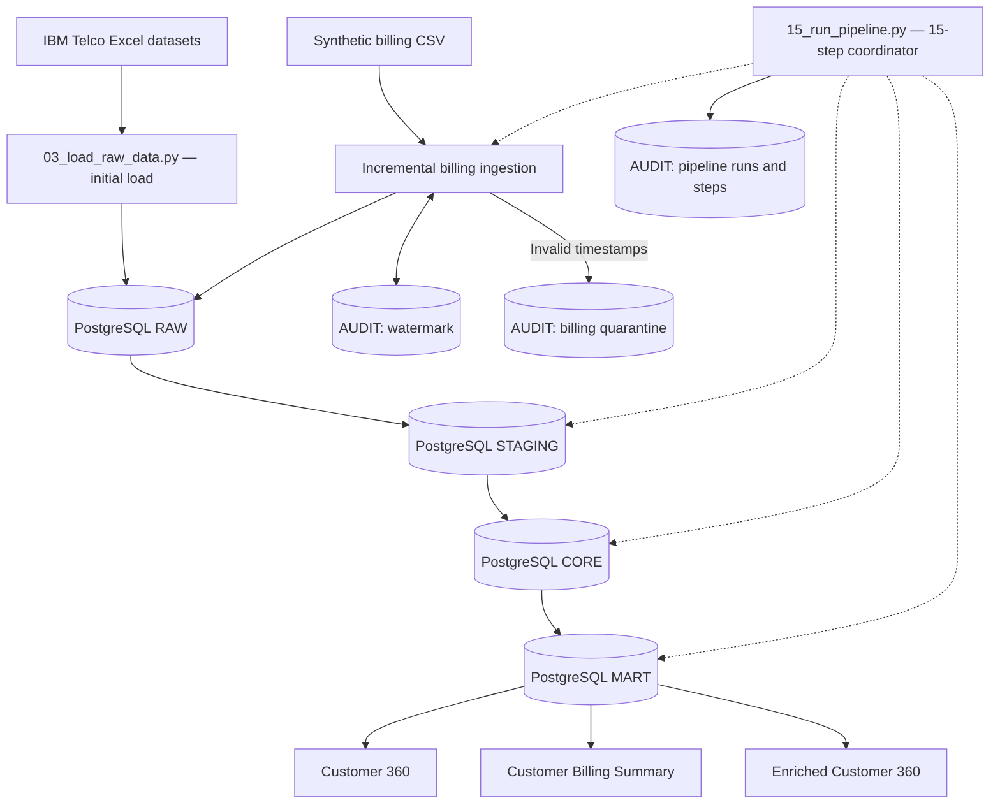

# Telco Customer 360 — End-to-End Data Engineering Pipeline

A Python and PostgreSQL data engineering project that integrates customer, churn, and billing data into a multi-layer analytical warehouse. It includes incremental ingestion, watermark tracking, UPSERT operations, data quality validation, quarantine and recovery exercises, and pipeline auditing.

## Project Overview

The project combines five IBM Telco Customer Churn datasets—demographics, location, population, services, and customer status—with a synthetic billing transactions dataset.

Python handles source ingestion and coordinates SQL transformations. PostgreSQL stores the data across **RAW**, **STAGING**, **CORE**, and **MART** schemas. An additional **AUDIT** schema tracks pipeline execution, incremental checkpoints, and quarantined billing records.

The main pipeline runs **15 sequential processing and validation steps** through `src/15_run_pipeline.py`. The initial Excel-to-RAW load is performed separately.

## Project Objectives

- Integrate customer and billing data into a centralized analytical warehouse.
- Separate ingestion, transformation, trusted storage, and reporting layers.
- Ingest new and changed billing transactions incrementally.
- Preserve historical billing versions in RAW while maintaining the latest bill state in CORE.
- Detect invalid source timestamps and support controlled recovery.
- Validate data quality and relationships across warehouse layers.
- Record pipeline runs and step-level execution outcomes for traceability.

## Technology Stack

| Technology | Usage |
|---|---|
| Python | Source ingestion, synthetic billing generation, and pipeline execution |
| PostgreSQL | Relational data warehouse and audit storage |
| SQL | Transformations, validations, analytical marts, and UPSERT logic |
| pandas and NumPy | Data processing and synthetic data generation |
| SQLAlchemy and psycopg2 | Python-to-PostgreSQL connectivity |

**Current scope:** A batch-oriented data engineering pipeline supporting both local Python/PostgreSQL execution and Docker Compose deployment. Airflow, dbt, cloud platforms, Spark, and Kafka are potential future extensions; they are not part of this version.

## Datasets

| Dataset | Records | Purpose |
|---|---:|---|
| Customer demographics | 7,043 | Customer attributes |
| Customer location | 7,043 | Geographic attributes |
| Population | 1,671 | ZIP-code population reference |
| Customer services | 7,043 | Subscriptions, charges, and services |
| Customer status | 7,043 | Churn and customer status |
| Synthetic billing transactions | 42,258 unique bills | Monthly billing and payment information |

The five customer datasets originate from the **IBM Telco Customer Churn** sample data. The billing dataset was generated for this project using `src/16_generate_billing_data.py`.

**Data publication note:** The original IBM Excel files are excluded from the proposed public repository until their redistribution terms are confirmed. Users should obtain the source datasets from an authorized source and place them in `data/raw/` using the filenames listed below.

## Architecture



### Warehouse Layers

| Schema | Responsibility |
|---|---|
| `raw` | Retain ingested source records, including historical versions of updated bills |
| `staging` | Standardize and transform data; select the latest version of each bill |
| `core` | Store validated customer entities and the current trusted state of each bill |
| `mart` | Provide customer-level and billing-level analytical datasets |
| `audit` | Track pipeline runs, step results, watermarks, and billing quarantine cases |

### Analytical Marts

- `mart.customer_360`: Combined customer, service, location, and churn information.
- `mart.customer_billing_summary`: Customer-level billing aggregates and payment status metrics.
- `mart.customer_360_enriched`: Customer 360 data enriched with billing summary metrics.

## Detailed Pipeline Workflow

The main entry point is `src/15_run_pipeline.py`. It runs the following steps in order and records step outcomes in the AUDIT schema.

| Step | Pipeline stage | Description |
|---:|---|---|
| 1 | Transform Base STAGING | Transform customer source tables into STAGING |
| 2 | Validate Base STAGING | Check counts, transformations, and business rules |
| 3 | UPSERT Base CORE | Insert or update trusted customer data |
| 4 | Validate Base CORE | Check row counts and relationships |
| 5 | Incremental Billing RAW Load | Validate timestamps, quarantine invalid records, and ingest new or changed bills |
| 6 | Transform Billing STAGING | Select the latest RAW version per `bill_id` |
| 7 | Validate Billing STAGING | Check billing data quality and consistency |
| 8 | UPSERT Billing CORE | Insert new bills or update existing bills when newer versions arrive |
| 9 | Validate Billing Pipeline | Check billing integrity across layers |
| 10 | Build Customer 360 MART | Create `mart.customer_360` |
| 11 | Validate Customer 360 MART | Validate the customer mart |
| 12 | Build Billing Summary MART | Create `mart.customer_billing_summary` |
| 13 | Validate Billing Summary MART | Validate billing aggregates |
| 14 | Build Enriched Customer 360 MART | Create `mart.customer_360_enriched` |
| 15 | Validate Enriched Customer 360 MART | Validate the final enriched mart |

The five Excel source files are initially loaded into RAW by `src/03_load_raw_data.py`; that initial load is **not** one of the 15 recurring pipeline steps.

## Incremental Billing Ingestion

### Watermark Tracking

The billing loader reads its checkpoint from `audit.pipeline_watermark`. A valid source record is eligible for normal incremental ingestion when:

```sql
source.updated_at > last_watermark
```

For example, if the checkpoint is `2026-06-07 00:00:00`, a bill updated on `2026-06-08 00:00:00` qualifies for ingestion. Records at or before the checkpoint do not qualify through the normal incremental path.

The checkpoint is updated after a successful incremental load. It is a **processing checkpoint**, not necessarily the maximum timestamp present in every table.

### Historical Versions and UPSERT

When a bill changes from **Pending** to **Paid**, RAW can contain both versions:

| bill_id | payment_status | updated_at |
|---|---|---|
| `BILL-1001` | Pending | 2026-01-02 |
| `BILL-1001` | Paid | 2026-06-08 |

*This is an illustrative example, not an actual project bill ID.*

The billing STAGING transformation uses `ROW_NUMBER()` partitioned by `bill_id`, ordered by descending `updated_at` and ingestion timestamp, to retain the latest version for each bill. CORE uses PostgreSQL `INSERT ... ON CONFLICT DO UPDATE` logic to maintain one trusted record per bill and avoid replacing a newer record with an older version.

This separation allows historical versions to remain available in RAW without duplicating bills in STAGING or CORE.

## Data Quality, Quarantine, and Recovery

The billing ingestion process validates source timestamps before loading eligible records into RAW. Records with missing or invalid timestamps are recorded in `audit.billing_quarantine` for investigation.

### Recovery Scenarios Tested

| Scenario | Problem | Tested recovery approach |
|---|---|---|
| New bill | A new bill was quarantined because its timestamp was invalid | Correct the timestamp and use controlled recovery when the corrected timestamp is below the watermark |
| Existing bill, older update | A corrected Paid version had an `updated_at` earlier than the watermark | Recover the corrected version through a controlled process outside the normal incremental filter |
| Existing bill, newer update | A corrected Paid version had an `updated_at` later than the watermark | Process it through normal incremental ingestion |

The recovery exercises checked RAW history, latest-version selection in STAGING, CORE state, MART refreshes, and quarantine resolution.

**Test cleanup:** The synthetic recovery records were subsequently removed from the active warehouse, and the test-advanced watermark was restored. Quarantine records remain marked `RESOLVED` as an audit trail of the exercises. Recovery and cleanup scripts are **test-specific** and should not be run as part of normal pipeline execution.

## Validation Results

The final verified execution was **Pipeline Run 27**.

| Check | Verified result |
|---|---|
| Overall pipeline status | SUCCESS |
| Pipeline steps | 15 of 15 successful |
| Billing source rows checked | 42,258 |
| Invalid billing timestamps on final run | 0 |
| New or changed source bills on final run | 0 |
| Billing CORE inserted / updated / unchanged | 0 / 0 / 42,258 |
| RAW billing rows | 42,261 |
| STAGING billing rows | 42,258 |
| CORE billing rows | 42,258 |
| Synthetic recovery bill remaining in CORE | 0 |
| Quarantine test cases 4, 5, 6 | RESOLVED |
| Final billing watermark | `2026-06-07 00:00:00` |

The difference between RAW (42,261 rows) and STAGING/CORE (42,258 rows) is explained by **three additional historical versions** of existing bills retained in RAW. The row counts describe the **tested Run 27 database state**; a fresh database may initially have only one version per bill until updates are ingested.

### Example Verification Queries

```sql
SELECT 'RAW' AS layer, COUNT(*) AS total_rows FROM raw.billing_transactions
UNION ALL
SELECT 'STAGING', COUNT(*) FROM staging.billing_transactions
UNION ALL
SELECT 'CORE', COUNT(*) FROM core.billing_transactions;

SELECT pipeline_name, source_name, last_watermark
FROM audit.pipeline_watermark
WHERE pipeline_name = 'telco_customer_360'
  AND source_name = 'billing_transactions';

SELECT run_id, status, started_at, finished_at
FROM audit.pipeline_run
ORDER BY run_id DESC
LIMIT 5;
```

## Repository Structure

```text
telco-customer-360/
├── src/                  # Python ingestion, pipeline, and recovery-test scripts
├── sql/                  # Schema creation, transformation, validation, and recovery SQL
├── data/
│   ├── raw/              # Source Excel files (excluded from Git) and synthetic billing CSV
│   ├── test/             # Synthetic billing recovery test CSV files
│   └── processed/        # Reserved for generated outputs
├── notebooks/            # Reserved for exploratory notebooks
├── logs/                 # Local generated logs (excluded from Git)
├── requirements.txt      # Python dependencies
├── .gitignore            # Version-control exclusions
└── README.md             # Project documentation
```

Local folders such as `.venv/` and `backup file/` are intentionally excluded from the proposed public repository.

### Important Python Files

| File | Purpose |
|---|---|
| `src/01_data_understanding.py` | Explore source data |
| `src/03_load_raw_data.py` | Initial Excel-to-RAW ingestion |
| `src/15_run_pipeline.py` | Main 15-step pipeline |
| `src/16_generate_billing_data.py` | Generate synthetic billing data |
| `src/19_load_billing_raw.py` | Standalone incremental billing loader |
| `src/23_simulate_billing_update.py` | Simulate a billing status change |
| `src/34_*.py` through `src/52_*.py` | Quarantine, recovery, and controlled test scenarios |

### Important SQL Files

| File | Purpose |
|---|---|
| `sql/02_create_raw_tables.sql` | Initial RAW tables |
| `sql/06_transform_staging.sql` | Base STAGING transformation |
| `sql/08_create_core_tables.sql` | Base CORE tables |
| `sql/12_create_customer_360_mart.sql` | Customer 360 mart |
| `sql/14_create_pipeline_audit.sql` | Pipeline auditing structures |
| `sql/17_create_billing_raw_table.sql` | Billing RAW table |
| `sql/18_create_pipeline_watermark.sql` | Watermark checkpoint table |
| `sql/20_transform_billing_staging.sql` | Latest-version billing STAGING transformation |
| `sql/21_create_billing_core_table.sql` | Billing CORE table |
| `sql/25_upsert_base_core.sql` | Base CORE UPSERT |
| `sql/26_create_customer_billing_mart.sql` | Billing summary mart |
| `sql/28_create_enriched_customer_360_mart.sql` | Enriched Customer 360 mart |
| `sql/30_extend_pipeline_step_audit.sql` | Additional pipeline step metrics |
| `sql/33_create_billing_quarantine.sql` | Billing quarantine table |
| `sql/35_add_billing_quarantine_resolution.sql` | Quarantine resolution tracking |
| `sql/54_backup_billing_cleanup.sql` to `sql/56_restore_billing_watermark.sql` | Test cleanup and checkpoint restoration only |

Other SQL files contain validations, standalone loading logic, and recovery exercises.

## Running the Project Locally

### Prerequisites

- Python and a working virtual environment (the development environment used Python 3.14).
- PostgreSQL running locally, with a database named `telco_project`.
- Access to the five IBM Telco Excel source files.
- Python dependencies from `requirements.txt`.
- Database schemas and supporting tables initialized using the repository's SQL setup scripts.

The current Python scripts connect to PostgreSQL at `localhost:5432` using the `postgres` user and prompt for the database password. Adjust the connection settings in the scripts if your local environment differs.

### Install Python Dependencies (Windows Command Prompt)

From the project root:

```cmd
python -m venv .venv
.venv\Scripts\python.exe -m pip install -r requirements.txt
.venv\Scripts\python.exe -m pip check
```

### Prepare Source Files

Place the following source files in `data/raw/`:

```text
Telco_customer_churn_demographics.xlsx
Telco_customer_churn_location.xlsx
Telco_customer_churn_population.xlsx
Telco_customer_churn_services.xlsx
Telco_customer_churn_status.xlsx
billing_transactions.csv
```

The billing CSV is synthetic and can be generated using `src/16_generate_billing_data.py` once the necessary customer data is available. **Do not regenerate or overwrite the billing CSV in an existing tested environment without backing it up first.**

### Initialize and Run

1. Create the `telco_project` database in PostgreSQL.
2. Initialize the required schemas, tables, watermark, quarantine, and audit structures using the SQL scripts in `sql/`.
3. Load the five Excel datasets into RAW using `src/03_load_raw_data.py`.
4. Confirm that `data/raw/billing_transactions.csv` exists and the billing tables and watermark are initialized.
5. Run the main pipeline.

For an **already initialized database**, run:

```cmd
.venv\Scripts\python.exe src\15_run_pipeline.py
```

For the **initial Excel load** (run only after the RAW tables are created):

```cmd
.venv\Scripts\python.exe src\03_load_raw_data.py
```

**Fresh-install limitation:** The full SQL bootstrap order has not yet been tested from an empty database as a single automated setup. The initialization step above is therefore a manual prerequisite, not a claim that cloning the repository and running one command is sufficient. A clean-install script is a planned improvement.

## Running the Project with Docker

The project supports containerized execution using Docker and Docker Compose. PostgreSQL runs as a persistent database service, while the Python ETL pipeline runs as a temporary batch-processing container.

### Docker Prerequisites

- Docker Desktop installed and running, with Linux container support.
- Docker Compose available.
- The required IBM Telco Excel source files and synthetic billing CSV placed in `data/raw/`.
- A local `.env` file containing the PostgreSQL configuration.

Example `.env` configuration:

```env
POSTGRES_USER=postgres
POSTGRES_PASSWORD=your_database_password
POSTGRES_DB=telco_project
```

The `.env` file contains credentials and must not be committed to Git.

### Docker Architecture

Docker Compose defines two services:

| Service | Image | Purpose |
|---|---|---|
| `postgres` | `postgres:17` | PostgreSQL database hosting the RAW, STAGING, CORE, MART, and audit schemas |
| `pipeline` | `telco-customer-360-pipeline:dev` | Custom Python image containing the ETL scripts, SQL transformations, and Python dependencies |

The Python image is built using the project's `Dockerfile` and `requirements.txt`.

The services communicate over the Docker Compose network using the PostgreSQL hostname `postgres` and port `5432`.

PostgreSQL is also accessible from Windows through `localhost:5433`, while the existing locally installed PostgreSQL instance can continue using port `5432`.

### Docker Storage

Two storage mechanisms are used:

**PostgreSQL named volume**

```yaml
- telco_postgres_data:/var/lib/postgresql/data
```

Stores the database files persistently, allowing PostgreSQL container recreation without losing the stored database under normal volume-preserving operations.

**Python source-data bind mount**

```yaml
- ./data/raw:/app/data/raw:ro
```

Provides the Python container with read-only access to the source datasets stored in the project's Windows directory.

Source datasets are excluded from the Python image using `.dockerignore`. Changes to the mounted CSV can be read in subsequent pipeline runs without rebuilding the image.

### Build and Execute the Pipeline

From the project root, validate the Docker Compose configuration:

```cmd
docker compose config --quiet
```

Start the PostgreSQL database:

```cmd
docker compose up -d postgres
```

Build the Python application image:

```cmd
docker compose build pipeline
```

Execute the ETL pipeline:

```cmd
docker compose run --rm pipeline
```

The command creates a temporary Python container, executes `src/15_run_pipeline.py`, and removes the container after completion.

The PostgreSQL container and its database volume remain independent of the temporary pipeline container.

When Python or SQL source files change, rebuild the image before executing the updated pipeline:

```cmd
docker compose build pipeline
```

**Important:** The commands above assume the PostgreSQL database has already been initialized and populated. For a fresh database, the required schemas, RAW tables, audit structures, watermark, quarantine structures, and initial Excel ingestion must first be prepared using the project's existing setup scripts. This bootstrap process is not yet fully automated.

### Verify Pipeline Execution

Check recent pipeline execution records:

```cmd
docker compose exec postgres psql -U postgres -d telco_project -c "SELECT run_id, status, started_at, finished_at FROM audit.pipeline_run ORDER BY run_id DESC LIMIT 5;"
```

Check the recorded pipeline steps:

```cmd
docker compose exec postgres psql -U postgres -d telco_project -c "SELECT run_id, status, COUNT(*) AS total_steps FROM audit.pipeline_step GROUP BY run_id, status ORDER BY run_id, status;"
```

**Docker validation result (19 October 2026):**

- Docker pipeline Run ID: `1`
- Overall execution status: `SUCCESS`
- Successful pipeline steps: `15/15`
- Failed steps: `0`
- Billing records unchanged during the incremental run: `42,258`

These results were verified using the Python execution output and PostgreSQL audit tables.

### Useful Docker Commands

| Command | Purpose |
|---|---|
| `docker compose ps` | View running Compose containers |
| `docker compose ps -a` | View existing Compose containers, including stopped ones |
| `docker compose build pipeline` | Build or rebuild the Python image |
| `docker compose run --rm pipeline` | Execute the batch ETL pipeline |
| `docker compose up -d postgres` | Start PostgreSQL in the background |
| `docker compose down` | Stop and remove Compose containers and network, preserving named volumes by default |
| `docker image ls` | List local Docker images |

**Warning:** Avoid `docker compose down -v` unless intentionally deleting the PostgreSQL named volume and its stored data.

### Docker Limitations

- Database bootstrap and initial Excel ingestion are not yet automated for a clean deployment.
- The pipeline uses batch execution rather than continuous streaming.
- Docker Compose manages the services but does not schedule recurring ETL executions.
- Pipeline execution still depends on the existing incremental ingestion, validation, and recovery logic.

## Design Considerations and Limitations

- The project is designed for local batch processing, not real-time streaming.
- The billing watermark uses a strict `updated_at > last_watermark` condition. Late-arriving or corrected records at or below the checkpoint require controlled recovery; equal-timestamp edge cases need additional design consideration in a production system.
- Historical billing versions are retained in RAW; STAGING and CORE represent the latest known bill state rather than a full historical ledger.
- The recovery scripts demonstrate controlled exercises and are not a fully automated remediation service.
- The main pipeline is a Python coordinator, not an Apache Airflow DAG.
- The repository has not yet been verified with an end-to-end clean-database bootstrap.

## Future Improvements

- Automate fresh-database initialization and initial Excel-to-RAW ingestion to enable reproducible Docker deployments.
- Add automated unit and integration tests with **pytest** and CI checks using **GitHub Actions**.
- Orchestrate the pipeline using **Apache Airflow**.
- Evaluate **dbt Core** for modular SQL models, documentation, and testing.
- Explore one cloud provider and a managed analytical platform before adding distributed processing or streaming tools.

## Project Status

**Current status: Local and Dockerized pipelines validated.** The local PostgreSQL pipeline (Run 27) and Dockerized PostgreSQL pipeline (Run 1) both completed successfully, with all 15 processing and validation steps passing. Docker Compose now manages PostgreSQL and the Python ETL application. Full clean-environment database initialization remains a planned improvement.