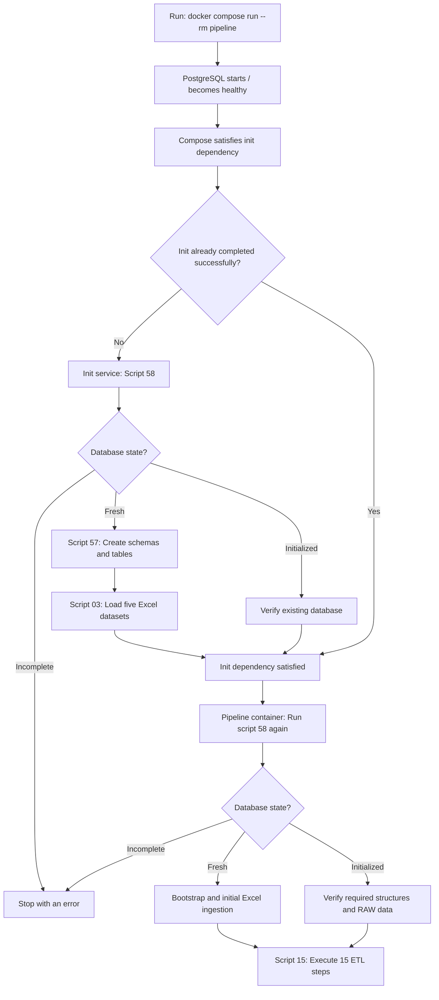
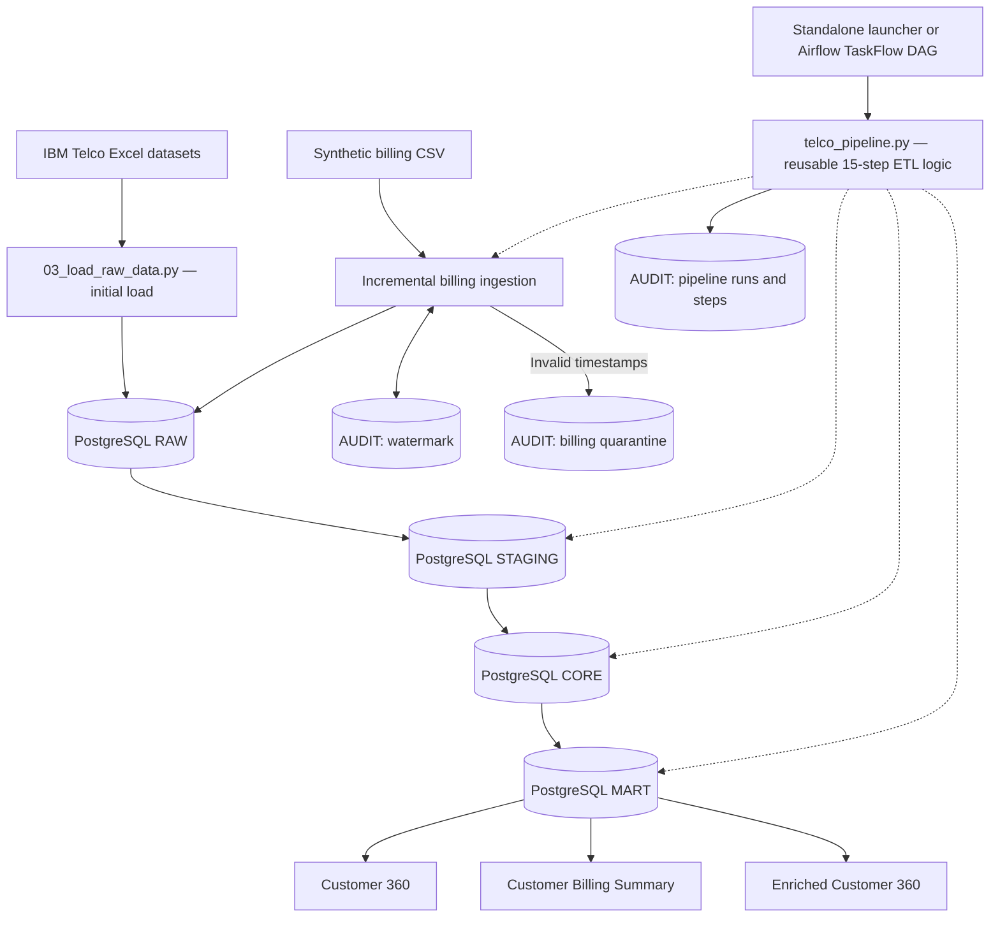
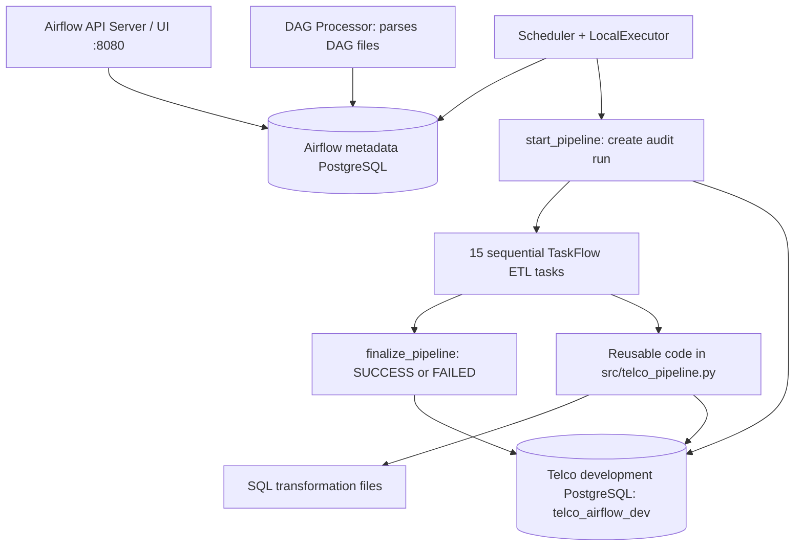
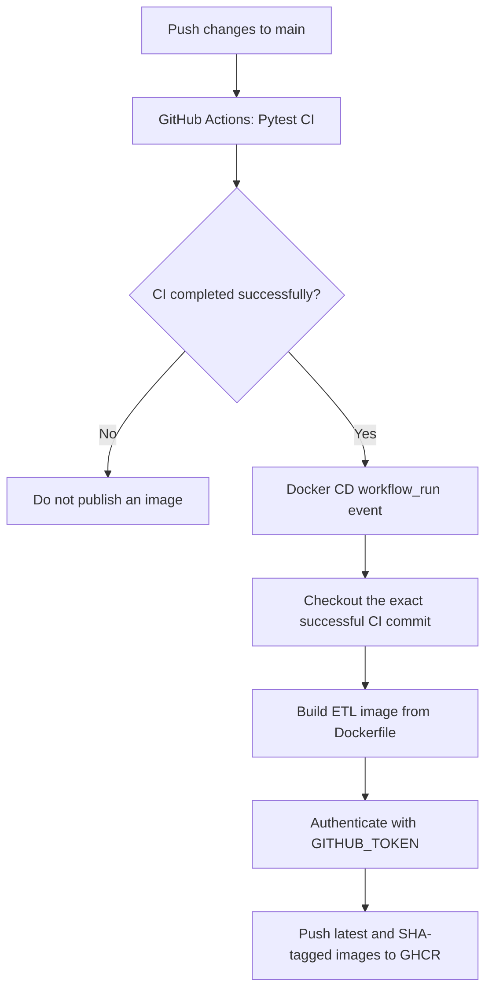

# Telco Customer 360 — End-to-End Data Engineering Pipeline

A local, end-to-end **data engineering portfolio project** that combines IBM Telco customer and churn data with synthetic billing transactions. It implements a PostgreSQL analytical warehouse, incremental ingestion and UPSERTs, data quality checks, audit trails, Dockerized execution, **Apache Airflow orchestration**, automated testing with **pytest and GitHub Actions**, and **Continuous Delivery to GitHub Container Registry (GHCR)**.

## At a glance

- **Data:** 7,043 customer records and 42,258 distinct synthetic billing transactions.
- **Warehouse:** PostgreSQL `raw` → `staging` → `core` → `mart` plus `audit`.
- **Orchestration:** Airflow 3.3.2, **15 individual ETL tasks + start/finalize (17 tasks)**.
- **Reliability:** source validations, quarantine, incremental version detection, UPSERT, audit/watermark tracking.
- **Verification:** 18 unit tests, 11 PostgreSQL integration tests, GitHub Actions CI checks passing, successful Airflow run.
- **Continuous Delivery:** CI-gated ETL Docker image publishing to GitHub Container Registry (GHCR).
- **Deployments:** standalone local Docker pipeline and an isolated Airflow development stack; **no automated cloud deployment**.

## Project Overview

The project combines five IBM Telco Customer Churn datasets—demographics, location, population, services, and customer status—with a synthetic billing transactions dataset.

Python handles source ingestion and coordinates SQL transformations. PostgreSQL stores the data across **RAW**, **STAGING**, **CORE**, and **MART** schemas. An additional **AUDIT** schema tracks pipeline execution, incremental checkpoints, and quarantined billing records.

The repository supports two ways to run the same 15-step ETL logic: a **standalone Python/Docker Compose pipeline** and a separate **Airflow 3 development environment**. The standalone Compose setup initializes an empty warehouse using `src/58_initialize_if_needed.py`, `src/57_bootstrap_database.py`, and `src/03_load_raw_data.py`. The Airflow TaskFlow DAG runs each of the 15 existing ETL steps as its own task, with start/finalize audit tasks around them. The actual transformations and validations live in `src/telco_pipeline.py`; `src/15_run_pipeline.py` remains the standalone launcher.

## Project Objectives

- Integrate customer and billing data into a centralized analytical warehouse.
- Separate ingestion, transformation, trusted storage, and reporting layers.
- Ingest new and changed billing transactions incrementally.
- Preserve historical billing versions in RAW while maintaining the latest bill state in CORE.
- Detect invalid source timestamps and support controlled recovery.
- Validate data quality and relationships across warehouse layers.
- Record pipeline runs and step-level execution outcomes for traceability.
- Orchestrate and observe individual ETL steps using Apache Airflow.
- Automatically validate the code with unit tests, isolated PostgreSQL integration tests, and GitHub Actions.
- Build and publish a versioned ETL container image to GHCR after successful CI on `main`.

## Technology Stack

| Technology | Usage |
|---|---|
| Python | Source ingestion, synthetic billing generation, and pipeline execution |
| PostgreSQL | Relational data warehouse and audit storage |
| SQL | Transformations, validations, analytical marts, and UPSERT logic |
| pandas and NumPy | Data processing and synthetic data generation |
| SQLAlchemy and psycopg2 | Python-to-PostgreSQL connectivity |
| Docker and Docker Compose | Containerization, PostgreSQL healthchecks, database bootstrap, and isolated test/Airflow environments |
| Apache Airflow 3.3.2 | TaskFlow DAGs, dependencies, LocalExecutor, and ETL monitoring |
| pytest | Unit tests and PostgreSQL-backed integration tests |
| Git and GitHub Actions | Version control, pull requests, automated CI, and the CD workflow |
| GitHub Container Registry (GHCR) | Stores the built and versioned ETL application Docker images |
| pgAdmin 4 (optional) | Inspecting PostgreSQL schemas, data, and audit records |

**Current scope:** A **local batch-processing** data platform with two orchestration paths (standalone Python or Airflow), automated CI, and **Continuous Delivery of the ETL Docker image**. The Airflow DAG is manually triggered (`schedule=None`); recurring scheduling, automatic deployment of a running environment, Spark, Kafka, and dbt are **not** implemented in this project.

## Datasets

| Dataset | Records | Purpose |
|---|---:|---|
| Customer demographics | 7,043 | Customer attributes |
| Customer location | 7,043 | Geographic attributes |
| Population | 1,671 | ZIP-code population reference |
| Customer services | 7,043 | Subscriptions, charges, and services |
| Customer status | 7,043 | Churn and customer status |
| Synthetic billing transactions | 42,258 unique bills | Monthly billing and payment information |

The five customer datasets originate from the **IBM Telco Customer Churn** sample data. The billing dataset was generated for this project using `src/16_generate_billing_data.py`.

**Data publication note:** The original IBM Excel files are excluded from the public repository until their redistribution terms are confirmed. Users should obtain the source datasets from an authorized source and place them in `data/raw/` using the filenames listed below.

## Architecture

### Standalone Docker Compose Initialization and Execution

This diagram describes the **standalone `compose.yaml` deployment**, not the separate Airflow environment. Docker Compose coordinates three services: **`postgres`**, **`init`**, and **`pipeline`**. The `init` service waits for PostgreSQL to pass its healthcheck; the `pipeline` service waits for `init` to complete successfully. On a fresh database, `init` runs the coordinator (`src/58_initialize_if_needed.py`), which invokes the schema/table bootstrap (`src/57_bootstrap_database.py`) and initial Excel ingestion (`src/03_load_raw_data.py`). On an already initialized database, the coordinator verifies its expected state instead.

Compose may reuse a previously successful `init` container. Therefore the pipeline container **also runs script 58 before every execution of script 15**. The precheck can initialize a fresh database if needed, or stop on an incomplete one.



**Note:** The `init` service and the pipeline's precheck use the same coordinator. On a normal first run, the initialization happens in `init`, while the second check only verifies the result. An exited `init` dependency does not imply that it is rerun for every pipeline invocation.

### Data Warehouse Architecture



### Apache Airflow Architecture

Airflow runs in an **isolated development stack** defined in `compose.airflow.yaml`, using a separate PostgreSQL warehouse (`telco_airflow_dev`) from both the standalone environment and the Airflow metadata database.



The DAG Processor discovers task definitions and dependencies without executing the ETL. The Scheduler selects ready tasks, and **LocalExecutor workers associated with the scheduler container** run the Python functions. Docker bind mounts expose `src/`, `sql/`, and `data/raw/` to the execution environment. The Airflow metadata database tracks DAG/task states; `telco_airflow_dev` stores the warehouse tables and application audit records.

### Warehouse Layers

| Schema | Responsibility |
|---|---|
| `raw` | Retain ingested source records, including historical versions of updated bills |
| `staging` | Standardize and transform data; select the latest version of each bill |
| `core` | Store validated customer entities and the current trusted state of each bill |
| `mart` | Provide customer-level and billing-level analytical datasets |
| `audit` | Track pipeline runs, step results, watermarks, and billing quarantine cases |

### Analytical Marts

- `mart.customer_360`: Combined customer, service, location, and churn information.
- `mart.customer_billing_summary`: Customer-level billing aggregates and payment status metrics.
- `mart.customer_360_enriched`: Customer 360 data enriched with billing summary metrics.

## Detailed Pipeline Workflow

The recurring processing logic is implemented in `src/telco_pipeline.py`. The standalone launcher `src/15_run_pipeline.py` executes all 15 steps in one Python process; `airflow/dags/telco_customer_360_tasks.py` invokes those same steps as **15 separately visible, sequential Airflow tasks**. Both paths record processing outcomes in the `audit` schema.

| Step | Pipeline stage | Description |
|---:|---|---|
| 1 | Transform Base STAGING | Transform customer source tables into STAGING |
| 2 | Validate Base STAGING | Check counts, transformations, and business rules |
| 3 | UPSERT Base CORE | Insert or update trusted customer data |
| 4 | Validate Base CORE | Check row counts and relationships |
| 5 | Incremental Billing RAW Load | Validate timestamps, quarantine invalid records, and ingest new or changed bills |
| 6 | Transform Billing STAGING | Select the latest RAW version per `bill_id` |
| 7 | Validate Billing STAGING | Check billing data quality and consistency |
| 8 | UPSERT Billing CORE | Insert new bills or update existing bills when newer versions arrive |
| 9 | Validate Billing Pipeline | Check billing integrity across layers |
| 10 | Build Customer 360 MART | Create `mart.customer_360` |
| 11 | Validate Customer 360 MART | Validate the customer mart |
| 12 | Build Billing Summary MART | Create `mart.customer_billing_summary` |
| 13 | Validate Billing Summary MART | Validate billing aggregates |
| 14 | Build Enriched Customer 360 MART | Create `mart.customer_360_enriched` |
| 15 | Validate Enriched Customer 360 MART | Validate the final enriched mart |

The five Excel source files are initially loaded into RAW by `src/03_load_raw_data.py`; that initial load is **not** one of the 15 recurring pipeline steps.

## Incremental Billing Ingestion

### Watermark Tracking

The billing loader stores a checkpoint in `audit.pipeline_watermark`. The **current implementation does not simply discard every source record with `updated_at <= last_watermark`**. It compares source versions against versions already in RAW using the `(bill_id, updated_at)` key and checks source payload consistency. This also allows an **unseen, late-arriving historical version** to be ingested even when its timestamp is older than the watermark.

```text
Source CSV -> validate dates and identifiers -> quarantine invalid timestamps
           -> identify unseen (bill_id, updated_at) versions
           -> insert unseen versions in RAW -> advance watermark only forward
```

For example, with a checkpoint of `2026-06-07`, an unseen valid source version dated `2026-06-05` may still be loaded into RAW. If a new version has a later timestamp, the checkpoint advances to the maximum; it never moves backward. RAW preserves versions, while STAGING and CORE use latest-version logic. A repeated source version is skipped; conflicting payloads for an existing version key are rejected for investigation.

The checkpoint is a **progress marker**, not the sole selection criterion in the current ingestion implementation. Invalid timestamps still require investigation and correction rather than guessing missing values.

### Historical Versions and UPSERT

When a bill changes from **Pending** to **Paid**, RAW can contain both versions:

| bill_id | payment_status | updated_at |
|---|---|---|
| `BILL-1001` | Pending | 2026-01-02 |
| `BILL-1001` | Paid | 2026-06-08 |

*This is an illustrative example, not an actual project bill ID.*

The billing STAGING transformation uses `ROW_NUMBER()` partitioned by `bill_id`, ordered by descending `updated_at` and ingestion timestamp, to retain the latest version for each bill. CORE uses PostgreSQL `INSERT ... ON CONFLICT DO UPDATE` logic to maintain one trusted record per bill and avoid replacing a newer record with an older version.

This separation allows historical versions to remain available in RAW without duplicating bills in STAGING or CORE.

## Data Quality, Quarantine, and Recovery

The billing ingestion process validates source timestamps before loading eligible records into RAW. Records with missing or invalid timestamps are recorded in `audit.billing_quarantine` for investigation.

### Recovery Scenarios Tested

| Scenario | Problem | Tested recovery approach |
|---|---|---|
| New bill | A bill is quarantined because its source timestamp is invalid | Investigate and correct the source; then reprocess the valid version and resolve its quarantine entry |
| Existing bill, older update | A corrected version arrives with an `updated_at` earlier than the watermark | The current unseen-version comparison can ingest it without moving the watermark backward |
| Existing bill, newer update | A corrected version arrives with an `updated_at` later than the watermark | Ingest the unseen version and advance the watermark when appropriate |

The recovery exercises checked RAW history, latest-version selection in STAGING, CORE state, MART refreshes, and quarantine resolution. The remaining manual investigation/resolution process is not a fully automated remediation system.

**Test cleanup:** The synthetic recovery records were subsequently removed from the active warehouse, and the test-advanced watermark was restored. Quarantine records remain marked `RESOLVED` as an audit trail of the exercises. Recovery and cleanup scripts are **test-specific** and should not be run as part of normal pipeline execution.

## Validation Results

Validation results below refer to **separate local and Docker PostgreSQL databases**. Their RAW counts may differ because of historical billing versions and prior recovery tests.

### Local PostgreSQL Validation — Run 27

| Check | Verified result |
|---|---|
| Overall pipeline status | SUCCESS |
| Pipeline steps | 15 of 15 successful |
| Billing source rows checked | 42,258 |
| Invalid billing timestamps on final run | 0 |
| New or changed source bills on final run | 0 |
| Billing CORE inserted / updated / unchanged | 0 / 0 / 42,258 |
| RAW billing rows | 42,261 |
| STAGING billing rows | 42,258 |
| CORE billing rows | 42,258 |
| Synthetic recovery bill remaining in CORE | 0 |
| Quarantine test cases 4, 5, 6 | RESOLVED |
| Final billing watermark | `2026-06-07 00:00:00` |

The difference between RAW (42,261 rows) and STAGING/CORE (42,258 rows) is explained by **three additional historical versions** of existing bills retained in RAW. This is the documented local Run 27 state; it is not the expected RAW count for every fresh installation.

### Docker Compose Validation — Phase 4

| Test | Verified result |
|---|---|
| Fresh database bootstrap | Five project schemas created and nine SQL initialization scripts executed |
| Initial Excel source ingestion | 29,843 RAW rows across five tables |
| Fresh end-to-end Docker test | 15 of 15 ETL steps successful (Run ID 1) |
| Billing records on first fresh run | 42,258 inserted into CORE |
| Main Docker database pipeline rerun | 15 of 15 ETL steps successful (Run ID 3) |
| Billing results on main Docker rerun | 0 inserted / 0 updated / 42,258 unchanged |
| Main Docker billing watermark | `2026-06-07 00:00:00` |
| Repeated initialization | Existing database detected; initial Excel ingestion skipped |
| Container recreation check | Existing billing data and watermark preserved with the named volume |

These Docker results were observed during local testing. The main Docker database and the isolated fresh-install test use different volumes; they should not be confused with the separate local PostgreSQL Run 27 environment.

### Example Verification Queries

```sql
SELECT 'RAW' AS layer, COUNT(*) AS total_rows FROM raw.billing_transactions
UNION ALL
SELECT 'STAGING', COUNT(*) FROM staging.billing_transactions
UNION ALL
SELECT 'CORE', COUNT(*) FROM core.billing_transactions;

SELECT pipeline_name, source_name, last_watermark
FROM audit.pipeline_watermark
WHERE pipeline_name = 'telco_customer_360'
  AND source_name = 'billing_transactions';

SELECT run_id, status, started_at, finished_at
FROM audit.pipeline_run
ORDER BY run_id DESC
LIMIT 5;
```

## Apache Airflow Execution and Verification

### Airflow services

| Service | Responsibility |
|---|---|
| `airflow-db` | PostgreSQL storage for Airflow's metadata, not business data |
| `airflow-init` | Airflow metadata migration/initialization (exits on success) |
| `airflow-dag-processor` | Parse and serialize DAG definitions |
| `airflow-scheduler` | Schedule task instances and run them using LocalExecutor worker processes |
| `airflow-api-server` | Airflow UI and APIs at `http://localhost:8080` |
| `telco-warehouse-dev` | Isolated PostgreSQL warehouse: `telco_airflow_dev` |
| `telco-etl-dev` | Optional standalone ETL container for manual execution |

The project includes three DAG files:

- `telco_airflow_learning.py`: introductory learning DAG.
- `telco_customer_360_pipeline.py`: **Phase 1**, one Airflow task launches the complete standalone pipeline.
- `telco_customer_360_tasks.py`: **Phase 2**, one audit-start task + 15 individual ETL tasks + one audit-finalizer task (**17 Airflow tasks**).

The Phase 2 DAG uses TaskFlow return values (XCom) to pass the **PostgreSQL audit Run ID** from `start_pipeline` to downstream tasks. The audit finalizer uses `all_done` and verifies that all 15 distinct expected ETL audit steps succeeded; an incomplete/failed run is recorded as FAILED and the finalizer raises an exception. Infrastructure interruptions can still leave an audit run needing manual reconciliation.

### Start and inspect the Airflow development environment

**Prerequisites:** Docker Desktop, the required local source files, and a local `.env.airflow` containing the secrets expected by `compose.airflow.yaml` (never commit it). On a fresh Airflow development warehouse, first use the project's database bootstrap and initial Excel ingestion process; the DAG is the **recurring pipeline**, not the initial database setup.

From the project root (Windows CMD):

```cmd
docker compose --env-file .env.airflow -f compose.airflow.yaml config --quiet
docker compose --env-file .env.airflow -f compose.airflow.yaml up -d --build
```

Inspect the containers and confirm the DAG is parsed:

```cmd
docker compose --env-file .env.airflow -f compose.airflow.yaml ps
docker compose --env-file .env.airflow -f compose.airflow.yaml exec airflow-dag-processor airflow tasks list telco_customer_360_tasks
```

Open **http://localhost:8080**, select **`telco_customer_360_tasks`**, inspect the Graph view, and manually trigger a run. The DAG has **`schedule=None`** and will not run on a timer until a schedule is explicitly configured. Do not run Phase 1 and Phase 2 simultaneously against the same development warehouse.

The development warehouse can optionally be accessed in pgAdmin 4 through `127.0.0.1:5438` (container port `5432`) if the port mapping remains enabled in `compose.airflow.yaml`; the container-network hostname is `telco-warehouse-dev`. This is **not** the original local `telco_project` database.

### Airflow execution evidence

The tested Phase 2 run completed with **17/17 Airflow tasks successful**. The corresponding warehouse audit record in `telco_airflow_dev` was **Run ID 6, SUCCESS, 15/15 ETL steps successful, 0 failed**. A previous failed development run is retained as a distinct historical test run.

Example warehouse audit query (in pgAdmin 4 or psql, connected to `telco_airflow_dev`):

```sql
SELECT
    r.run_id,
    r.status AS pipeline_status,
    COUNT(s.step_id) AS total_steps,
    COUNT(s.step_id) FILTER (WHERE s.status = 'SUCCESS') AS successful_steps,
    COUNT(s.step_id) FILTER (WHERE s.status = 'FAILED') AS failed_steps
FROM audit.pipeline_run AS r
LEFT JOIN audit.pipeline_step AS s ON s.run_id = r.run_id
GROUP BY r.run_id, r.status
ORDER BY r.run_id DESC
LIMIT 5;
```

> Optional portfolio evidence: save a screenshot of the successful Airflow Graph to `docs/images/airflow-tasks-success.png` and embed it in this README with `` **after** adding the actual image file to the repository.

## Automated Testing and GitHub Actions

| Test type | Command | Verified result |
|---|---|---|
| Unit tests | `.venv\Scripts\python.exe -m pytest tests -v` | **18 passed** locally |
| PostgreSQL integration tests | `.venv\Scripts\python.exe -m pytest integration_tests -v` | **11 passed** locally |
| GitHub Actions | `.github/workflows/pytest.yml` | **4/4 checks passed** on PR #7 (two jobs across push and PR events) |

The unit tests check Python-level behavior without requiring a live database. Integration tests use PostgreSQL 17, test actual transactions and database operations, and **must** target the separate database `telco_test` on local host port `5437` (not `telco_project` or `telco_airflow_dev`). The CI workflow initializes its own ephemeral test database.

For local integration tests, use the **explicit Compose project name** expected by the test harness:

```cmd
docker compose -p telco-integration-test -f compose.integration.yaml up -d postgres_test
.venv\Scripts\python.exe -m pytest integration_tests -v --tb=short
```

The integration database must also contain the required fixture schemas/tables and initial watermark before running the full suite. Starting an empty PostgreSQL container alone is **not** enough to set these up; follow the integration-test bootstrap used by the CI workflow if starting from a fresh volume. The explicit `-p telco-integration-test` matters because one integration test executes `docker compose` against that project name.

`pytest.ini` defaults to discovering the `tests/` directory, so use `pytest integration_tests -v` explicitly for database-backed tests. The refactored tests import the reusable `src/telco_pipeline.py` logic instead of the launcher.

### Database environments are isolated

| Environment | Database | Access |
|---|---|---|
| Original local development | `telco_project` | Local PostgreSQL on `localhost:5432` |
| Standalone Docker deployment | `telco_project` | `127.0.0.1:5433` -> container `5432` |
| Local integration testing | `telco_test` | `127.0.0.1:5437` -> container `5432` |
| Airflow development warehouse | `telco_airflow_dev` | `127.0.0.1:5438` -> container `5432` (when published) |
| Airflow metadata database | Separate Airflow internal database | Docker internal network only |

## Continuous Delivery — Docker Image Publishing

The project also includes a **Continuous Delivery (CD)** workflow at `.github/workflows/publish-etl-image.yml`. Unlike the CI workflow, which verifies code behavior, the CD workflow packages the tested ETL application as a Docker image and publishes it to **GitHub Container Registry (GHCR)**. This is **image delivery**, not deployment of a running Airflow/PostgreSQL environment.

### CI-to-CD workflow



The workflow responds to completion of `Telco Customer 360 - Pytest CI` and publishes only when the triggering CI run succeeded **and** originated from a `push` on `main` in this repository. It uses the CI run's `head_sha` to build the tested commit, Docker Buildx for image building, and the built-in GitHub Actions `GITHUB_TOKEN` with `packages: write` permission.

### Image names and verification

The workflow publishes the **ETL application image** built with the repository's `Dockerfile` under these tags:

```text
ghcr.io/firdaushussin03/telco-customer-360:latest
ghcr.io/firdaushussin03/telco-customer-360:sha-<full-git-commit-sha>
```

The `latest` tag identifies the latest successfully published image, while `sha-...` identifies the source commit. The container package may initially be private; public pulling requires adjusting visibility under the GitHub package settings. The workflow does **not** build or publish the separate `Dockerfile.airflow` image.

**Recorded verification:** GitHub Actions showed **Docker CD workflow run #1 completed successfully**. To independently confirm the expected image was actually published, open the successful job's `Build and publish ETL Docker image` step and check the repository owner's **Packages** page for the `telco-customer-360` container package. Once visibility and permissions permit, the image can be retrieved with:

```cmd
docker pull ghcr.io/firdaushussin03/telco-customer-360:latest
```

Pulling the image demonstrates registry distribution; it does not by itself test the application with database credentials, source files, or a configured runtime. The published image does not contain the local IBM datasets or `.env` secrets; those must be supplied by the environment that runs it.

### CI versus CD versus deployment

| Stage | Status | What it proves |
|---|---|---|
| Continuous Integration (CI) | Implemented | Automated unit and isolated PostgreSQL integration checks can pass |
| Continuous Delivery (CD) | Implemented; first workflow run successful | A tested commit can be built and published as a versioned ETL container image |
| Continuous Deployment | Not implemented | No automatic rollout to a running cloud server, Airflow scheduler, or production database |

The local Docker Compose and Airflow environments still run independently. Publishing a new ETL image does **not** automatically update the currently running containers, which use their own image-build/bind-mount configuration.

## Repository Structure

```text
telco-customer-360/
├── .github/workflows/pytest.yml             # GitHub Actions CI: unit + integration jobs
├── .github/workflows/publish-etl-image.yml  # GHCR image Continuous Delivery
├── airflow/dags/                 # Three Airflow DAGs
│   ├── telco_airflow_learning.py
│   ├── telco_customer_360_pipeline.py
│   └── telco_customer_360_tasks.py
├── compose.yaml                  # Standalone PostgreSQL + init + pipeline
├── compose.airflow.yaml          # Airflow + isolated development warehouse
├── compose.integration.yaml      # Isolated PostgreSQL integration tests
├── Dockerfile                    # Standalone ETL image
├── Dockerfile.airflow            # Custom Airflow task-execution image
├── src/
│   ├── 03_load_raw_data.py       # Initial five-Excel ingestion
│   ├── 15_run_pipeline.py        # Small standalone launcher
│   ├── telco_pipeline.py         # Reusable 15-step ETL logic
│   ├── telco_airflow_steps.py    # Step wrappers and audit helpers
│   ├── 16_generate_billing_data.py
│   ├── 57_bootstrap_database.py
│   └── 58_initialize_if_needed.py
├── sql/                          # SQL setup, transformations, and marts
├── data/raw/                     # Source datasets (not all tracked)
├── tests/                        # Unit tests
├── integration_tests/            # Database-backed integration tests
├── pytest.ini
├── requirements.txt
├── requirements-dev.txt
└── README.md
```

The tree shows the main tracked components, not every implementation or test file. Local-only files such as `.venv/`, database credentials (`.env`, `.env.airflow`, `.env.integration`), and generated logs should never be committed. Some local diagnostic and recovery scripts are intentionally excluded from version control.

### Important Python Files

| File | Purpose |
|---|---|
| `src/01_data_understanding.py` | Explore source data |
| `src/03_load_raw_data.py` | Initial Excel-to-RAW ingestion with source preflight and transaction handling |
| `src/15_run_pipeline.py` | Standalone launcher that calls `telco_pipeline.main()` |
| `src/telco_pipeline.py` | Reusable 15-step ETL functions and pipeline coordinator |
| `src/telco_airflow_steps.py` | Callable per-step ETL wrappers and audit start/finalize functions |
| `airflow/dags/telco_customer_360_tasks.py` | Full TaskFlow DAG: 15 ETL tasks plus start/finalize |
| `src/16_generate_billing_data.py` | Generate synthetic billing data |
| `src/19_load_billing_raw.py` | Standalone incremental billing loader |
| `src/23_simulate_billing_update.py` | Simulate a billing status change |
| `src/34_*.py` through `src/52_*.py` | Quarantine, recovery, and controlled test scenarios |
| `src/57_bootstrap_database.py` | Create required schemas and tables in a fresh PostgreSQL database |
| `src/58_initialize_if_needed.py` | Detect database state, initialize if fresh, and verify existing setup |

### Important SQL Files

| File | Purpose |
|---|---|
| `sql/02_create_raw_tables.sql` | Initial RAW tables |
| `sql/06_transform_staging.sql` | Base STAGING transformation |
| `sql/08_create_core_tables.sql` | Base CORE tables |
| `sql/12_create_customer_360_mart.sql` | Customer 360 mart |
| `sql/14_create_pipeline_audit.sql` | Pipeline auditing structures |
| `sql/17_create_billing_raw_table.sql` | Billing RAW table |
| `sql/18_create_pipeline_watermark.sql` | Watermark checkpoint table |
| `sql/20_transform_billing_staging.sql` | Latest-version billing STAGING transformation |
| `sql/21_create_billing_core_table.sql` | Billing CORE table |
| `sql/25_upsert_base_core.sql` | Base CORE UPSERT |
| `sql/26_create_customer_billing_mart.sql` | Billing summary mart |
| `sql/28_create_enriched_customer_360_mart.sql` | Enriched Customer 360 mart |
| `sql/30_extend_pipeline_step_audit.sql` | Additional pipeline step metrics |
| `sql/33_create_billing_quarantine.sql` | Billing quarantine table |
| `sql/35_add_billing_quarantine_resolution.sql` | Quarantine resolution tracking |
| `sql/54_backup_billing_cleanup.sql` to `sql/56_restore_billing_watermark.sql` | Test cleanup and checkpoint restoration only |

Other SQL files contain validations, standalone loading logic, and recovery exercises.

## Running the Project Locally

Local Python execution is supported as an alternative to Docker. The Docker workflow below is the recommended path for testing the full automated initialization sequence.

### Prerequisites

- Python and a working virtual environment (development used Python 3.14).
- PostgreSQL running locally, with a database named `telco_project`.
- Access to the five IBM Telco Excel source files and the synthetic billing CSV.
- Python dependencies from `requirements.txt`.

Local scripts may use application-specific connection settings or environment variables. Script 57 and script 58 require `DB_HOST`, `DB_PORT`, `DB_NAME`, `DB_USER`, and `DB_PASSWORD`. Script 03 accepts `DB_PASSWORD` from the environment or prompts for it. For local PostgreSQL development, the tested server used `localhost:5432`.

### Install Python Dependencies (Windows Command Prompt)

From the project root:

```cmd
python -m venv .venv
.venv\Scripts\python.exe -m pip install -r requirements.txt
.venv\Scripts\python.exe -m pip check
```

### Prepare Source Files

Place the following files in `data/raw/`:

```text
Telco_customer_churn_demographics.xlsx
Telco_customer_churn_location.xlsx
Telco_customer_churn_population.xlsx
Telco_customer_churn_services.xlsx
Telco_customer_churn_status.xlsx
billing_transactions.csv
```

The original IBM Excel files are not committed to this repository. The billing CSV is synthetic and can be generated using `src/16_generate_billing_data.py` once the necessary customer data is available. **Do not regenerate or overwrite a billing CSV in an existing tested environment without backing it up first.**

### Initialize and Run

For a **fresh local database**, first create the empty PostgreSQL database and configure the required `DB_*` environment variables for scripts 57 and 58. Then run:

```cmd
.venv\Scripts\python.exe src\58_initialize_if_needed.py
```

When the database has no project schemas, script 58 runs the SQL bootstrap and initial Excel ingestion. If all project schemas exist, it performs required state checks instead; if only some exist or required data is missing, it stops rather than overwriting the database.

After initialization, run the recurring ETL pipeline:

```cmd
.venv\Scripts\python.exe src\15_run_pipeline.py
```

This small launcher imports `main()` from `src/telco_pipeline.py`; the ETL implementation is no longer embedded directly in the numbered launcher file.

This local execution sequence was not the main clean-install acceptance test; the complete automated Docker Compose workflow below was tested end to end.

## Running the Project with Docker

Docker Compose supports initialization and repeatable batch execution using three services. The PostgreSQL service persists data; the Python `init` and `pipeline` services run one-time tasks.

### Docker Prerequisites

- Docker Desktop installed and running, with Linux container support.
- Docker Compose available.
- All five IBM Telco Excel source files in `data/raw/`.
- `data/raw/billing_transactions.csv` present, either supplied from a previous project run or generated with `src/16_generate_billing_data.py` after the required customer data is available.
- A local `.env` file containing the PostgreSQL configuration.

Example `.env`:

```env
POSTGRES_USER=postgres
POSTGRES_PASSWORD=your_database_password
POSTGRES_DB=telco_project
```

The `.env` file contains credentials and must **not** be committed to Git. The sample dataset files are not automatically downloaded by Docker Compose.

### Docker Architecture

| Service | Image | Purpose |
|---|---|---|
| `postgres` | `postgres:17` | Persistent PostgreSQL server with healthcheck |
| `init` | `telco-customer-360-pipeline:dev` | Runs `58_initialize_if_needed.py` after PostgreSQL becomes healthy |
| `pipeline` | `telco-customer-360-pipeline:dev` | Rechecks initialization and runs the main 15-step ETL |

Both Python services use the **same custom image**, built from `Dockerfile` and `requirements.txt`. The `init` service overrides the Dockerfile's default `CMD`; the `pipeline` service uses its Compose `command:` to run script 58 and then script 15.

Compose uses these dependency conditions:

```yaml
init:
  depends_on:
    postgres:
      condition: service_healthy

pipeline:
  depends_on:
    init:
      condition: service_completed_successfully
```

Services connect to PostgreSQL using hostname `postgres` and container port `5432`. The main Compose configuration publishes PostgreSQL to Windows at **`127.0.0.1:5433`**. A separate locally installed PostgreSQL server can continue using port `5432`.

### Docker Storage

**PostgreSQL named volume**

```yaml
- telco_postgres_data:/var/lib/postgresql/data
```

Stores PostgreSQL database files independently of the container. Normal container recreation can retain these files as long as the named volume is preserved; a volume is **not a database backup**.

**Read-only source-data bind mount**

```yaml
- ./data/raw:/app/data/raw:ro
```

Makes the local datasets available at `/app/data/raw` inside both Python containers. The `:ro` setting means the containers cannot modify the mounted source files. The raw datasets are not copied into the Python image; changes to the mounted CSV can be read by subsequent pipeline runs without rebuilding the image.

### Build and Run (Windows Command Prompt)

From the project root, validate the configuration:

```cmd
docker compose config --quiet
```

Build the Python application image (required for a fresh clone without the local image):

```cmd
docker compose build
```

Execute the complete workflow:

```cmd
docker compose run --rm pipeline
```

**What happens:** Compose ensures PostgreSQL is healthy, satisfies the `init` dependency successfully, then starts a temporary `pipeline` container. On a fresh database the initialization coordinator creates the five schemas, sets up the required tables and audit infrastructure, and loads the five IBM Excel datasets. The pipeline container runs the coordinator once more as a precheck and then executes all 15 ETL steps.

After a successful first run, the same `docker compose run --rm pipeline` command can be used for subsequent batch runs. The coordinator verifies an existing database instead of reloading the five initial Excel datasets. The billing loader compares source versions against existing RAW history and uses the watermark as a nondecreasing progress checkpoint.

**`--rm` removes only the one-off pipeline container.** PostgreSQL remains available, its named volume remains attached, and the regular `init` dependency container may remain stopped with exit code `0`.

If Python, SQL, or other files copied by the Dockerfile change, rebuild the image before running the updated code:

```cmd
docker compose build pipeline
```

Starting PostgreSQL separately is optional, because `run pipeline` starts its required dependencies when needed:

```cmd
docker compose up -d postgres
```

### Fresh Database and Rerun Safety

- **Fresh database:** Script 58 verifies the five Excel files exist, then runs `57_bootstrap_database.py` followed by `03_load_raw_data.py`.
- **Existing database:** Script 58 checks the five schemas, 16 required tables, selected critical columns, initial customer RAW row counts, and billing watermark record.
- **Incomplete database:** Script 58 stops with an error rather than dropping or resetting existing data.
- **Source validation:** The preflight confirms file existence. The ingestion and ETL layers perform further checks; the preflight does not validate every column or file's contents.

The bootstrap and initial Excel ingestion are separate transactions. If a failure occurs between them, automatic recovery from a partially initialized database is **not implemented**; investigate and repair the incomplete state before retrying. The checks also do not verify every possible data type, constraint, or data-quality issue. Source files must already be available in `data/raw/` for first-time execution.

### Verify Pipeline Execution

Check recent pipeline executions:

```cmd
docker compose exec -T postgres psql -U postgres -d telco_project -c "SELECT run_id, status, started_at, finished_at FROM audit.pipeline_run ORDER BY run_id DESC LIMIT 5;"
```

Check step-level audit summaries:

```cmd
docker compose exec -T postgres psql -U postgres -d telco_project -c "SELECT run_id, status, COUNT(*) AS total_steps FROM audit.pipeline_step GROUP BY run_id, status ORDER BY run_id, status;"
```

The commands above assume `POSTGRES_USER=postgres` and `POSTGRES_DB=telco_project`, as shown in the example `.env`. Adjust `-U` and `-d` if your values differ.

### Useful Docker Commands

| Command | Purpose |
|---|---|
| `docker compose config --quiet` | Validate the Compose configuration |
| `docker compose build` | Build images for all build-enabled services |
| `docker compose build pipeline` | Build or rebuild the shared Python image through the pipeline service |
| `docker compose run --rm init` | Run the initialization coordinator manually |
| `docker compose run --rm pipeline` | Run initialization checks and the 15-step ETL pipeline |
| `docker compose ps` | View currently running Compose containers |
| `docker compose ps -a` | Include stopped and exited Compose containers |
| `docker compose logs init` | View the init service's logs |
| `docker compose up -d postgres` | Start PostgreSQL in the background |
| `docker compose down` | Stop and remove Compose containers/networks while preserving named volumes by default |
| `docker image ls` | List local Docker images |

**Data safety warning:** Do not use `docker compose down -v` on a database you intend to preserve. The `-v` option removes Compose-managed named volumes and can delete stored database data.

### Docker Limitations

- Execution is batch-oriented, not continuous streaming.
- The **standalone** Docker Compose setup handles startup dependencies but does not schedule recurring ETL runs; Airflow orchestrates the separate development DAG (manually triggered by default).
- Automated initialization assumes the expected sample source files and counts.
- Full automated repair after partial initialization, stronger schema checking, and production-grade secrets handling are future improvements.

## Design Considerations and Limitations

- The project is designed for local batch processing, not real-time streaming.
- The current billing loader compares unseen `(bill_id, updated_at)` source versions against RAW and keeps the watermark nondecreasing. Equal-timestamp versions with conflicting payloads are rejected instead of silently overwritten; a production solution would need a stronger source CDC contract and monitoring.
- Historical billing versions are retained in RAW; STAGING and CORE represent the latest known bill state rather than a complete historical ledger.
- The recovery scripts demonstrate controlled exercises and are not a fully automated remediation service.
- Initialization verification covers specific required objects and expected initial row counts rather than exhaustive schema constraints or contents.
- Bootstrap and Excel ingestion run in separate transactions, and partial initialization needs investigation rather than automatic destructive cleanup.
- The project relies on the IBM Telco sample files and a synthetic billing CSV supplied or prepared locally; Docker Compose does not automatically obtain the source datasets.
- Airflow provides **task-level orchestration**, but the Phase 2 DAG has `schedule=None` and is triggered manually. Recurring schedules, alerting, remote workers, and failure recovery beyond the implemented audit finalization are not production-hardened.
- CD publishes the ETL Docker image only; it does **not** deploy running services, migrate a production database, or publish the separate Airflow image.

## Future Improvements

- Add a recurring Airflow schedule, failure alerts, and more robust recovery/cleanup of interrupted audit runs.
- Expand initialization checks to validate essential data types, constraints, source data contents, and a reliable completion marker.
- Introduce monitoring, secret management, and stronger concurrency controls for production-style deployments.
- Consider container image vulnerability scanning and a controlled staging deployment/rollback process if the project is later hosted.
- Evaluate **dbt Core** for modular SQL models, documentation, and testing.
- Explore managed cloud storage/warehousing and distributed processing in a **separate project**, rather than adding every tool to this learning repository.

## Project Status

**Current status: Complete local batch-pipeline implementation, Airflow orchestration, CI, and ETL image Continuous Delivery validated.** The local PostgreSQL pipeline (Run 27) and standalone Docker runs successfully completed their 15 steps. The separate Airflow development warehouse recorded **Run ID 6: SUCCESS, 15 successful audit steps, 0 failed**, and Airflow displayed **17/17 task successes**. Local pytest results were **18 unit tests + 11 PostgreSQL integration tests passed**. GitHub Actions showed **4/4 successful checks** on PR #7. The separate **Docker CD workflow run #1** also completed successfully after CI.

The Airflow implementation and test-import adjustments were merged into `main` via **PR #7**, merge commit `a20bef3`. This repository is a tested **local batch data engineering portfolio project with CI and GHCR image delivery**, not a production deployment. Source files, local credentials, initial database bootstrapping, and Docker prerequisites remain necessary; streaming ingestion, autonomous repair, scheduled Airflow runs, and managed cloud infrastructure are outside the current scope.
