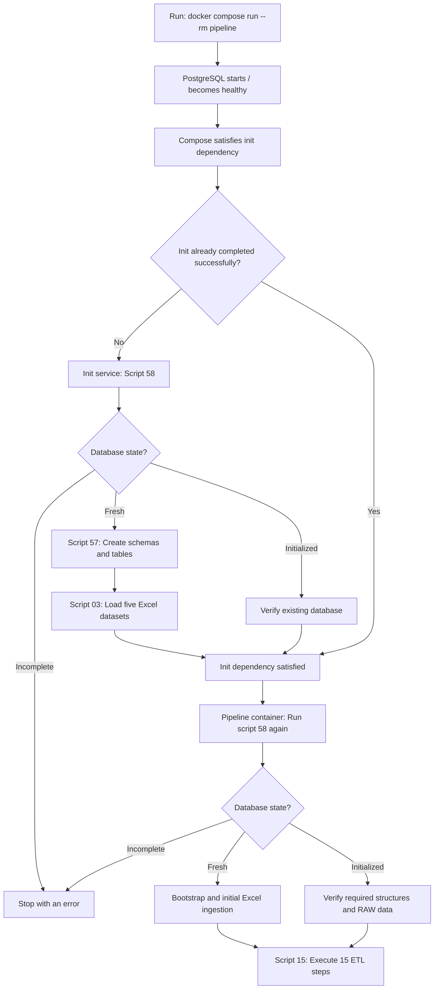
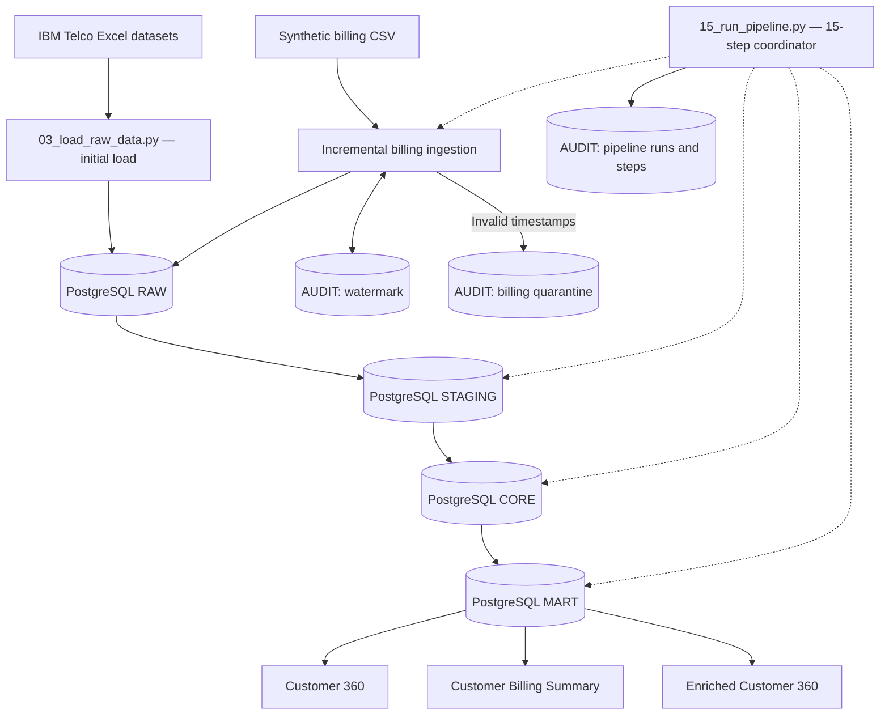

# Telco Customer 360 — End-to-End Data Engineering Pipeline

A Python and PostgreSQL data engineering project that integrates customer, churn, and billing data into a multi-layer analytical warehouse. It includes incremental ingestion, watermark tracking, UPSERT operations, data quality validation, quarantine and recovery exercises, and pipeline auditing.

## Project Overview

The project combines five IBM Telco Customer Churn datasets—demographics, location, population, services, and customer status—with a synthetic billing transactions dataset.

Python handles source ingestion and coordinates SQL transformations. PostgreSQL stores the data across **RAW**, **STAGING**, **CORE**, and **MART** schemas. An additional **AUDIT** schema tracks pipeline execution, incremental checkpoints, and quarantined billing records.

Through Docker Compose, the project supports automated database initialization and execution of the ETL pipeline. The initialization coordinator (`src/58_initialize_if_needed.py`) detects whether the PostgreSQL database is fresh or already initialized. For a fresh database, it executes the database bootstrap (`src/57_bootstrap_database.py`) and initial Excel ingestion (`src/03_load_raw_data.py`). For an existing database, it verifies the required structures and initial RAW data before the main pipeline (`src/15_run_pipeline.py`) executes its **15 sequential processing and validation steps**.

## Project Objectives

- Integrate customer and billing data into a centralized analytical warehouse.
- Separate ingestion, transformation, trusted storage, and reporting layers.
- Ingest new and changed billing transactions incrementally.
- Preserve historical billing versions in RAW while maintaining the latest bill state in CORE.
- Detect invalid source timestamps and support controlled recovery.
- Validate data quality and relationships across warehouse layers.
- Record pipeline runs and step-level execution outcomes for traceability.

## Technology Stack

| Technology | Usage |
|---|---|
| Python | Source ingestion, synthetic billing generation, and pipeline execution |
| PostgreSQL | Relational data warehouse and audit storage |
| SQL | Transformations, validations, analytical marts, and UPSERT logic |
| pandas and NumPy | Data processing and synthetic data generation |
| SQLAlchemy and psycopg2 | Python-to-PostgreSQL connectivity |
| Docker and Docker Compose | Containerization, PostgreSQL healthchecks, automated database initialization, and ETL service orchestration |

**Current scope:** A batch-oriented data engineering pipeline supporting both local Python/PostgreSQL execution and Docker Compose deployment. Airflow, dbt, cloud platforms, Spark, and Kafka are potential future extensions; they are not part of this version.

## Datasets

| Dataset | Records | Purpose |
|---|---:|---|
| Customer demographics | 7,043 | Customer attributes |
| Customer location | 7,043 | Geographic attributes |
| Population | 1,671 | ZIP-code population reference |
| Customer services | 7,043 | Subscriptions, charges, and services |
| Customer status | 7,043 | Churn and customer status |
| Synthetic billing transactions | 42,258 unique bills | Monthly billing and payment information |

The five customer datasets originate from the **IBM Telco Customer Churn** sample data. The billing dataset was generated for this project using `src/16_generate_billing_data.py`.

**Data publication note:** The original IBM Excel files are excluded from the public repository until their redistribution terms are confirmed. Users should obtain the source datasets from an authorized source and place them in `data/raw/` using the filenames listed below.

## Architecture

### Docker Compose Initialization and Execution

Docker Compose coordinates three services: **`postgres`**, **`init`**, and **`pipeline`**. The `init` service waits for PostgreSQL to pass its healthcheck; the `pipeline` service waits for `init` to complete successfully. On a fresh database, `init` runs the coordinator (`src/58_initialize_if_needed.py`), which invokes the schema/table bootstrap (`src/57_bootstrap_database.py`) and initial Excel ingestion (`src/03_load_raw_data.py`). On an already initialized database, the coordinator verifies its expected state instead.

Compose may reuse a previously successful `init` container. Therefore the pipeline container **also runs script 58 before every execution of script 15**. The precheck can initialize a fresh database if needed, or stop on an incomplete one.



**Note:** The `init` service and the pipeline's precheck use the same coordinator. On a normal first run, the initialization happens in `init`, while the second check only verifies the result. An exited `init` dependency does not imply that it is rerun for every pipeline invocation.

### Data Warehouse Architecture



### Warehouse Layers

| Schema | Responsibility |
|---|---|
| `raw` | Retain ingested source records, including historical versions of updated bills |
| `staging` | Standardize and transform data; select the latest version of each bill |
| `core` | Store validated customer entities and the current trusted state of each bill |
| `mart` | Provide customer-level and billing-level analytical datasets |
| `audit` | Track pipeline runs, step results, watermarks, and billing quarantine cases |

### Analytical Marts

- `mart.customer_360`: Combined customer, service, location, and churn information.
- `mart.customer_billing_summary`: Customer-level billing aggregates and payment status metrics.
- `mart.customer_360_enriched`: Customer 360 data enriched with billing summary metrics.

## Detailed Pipeline Workflow

The main entry point is `src/15_run_pipeline.py`. It runs the following steps in order and records step outcomes in the AUDIT schema.

| Step | Pipeline stage | Description |
|---:|---|---|
| 1 | Transform Base STAGING | Transform customer source tables into STAGING |
| 2 | Validate Base STAGING | Check counts, transformations, and business rules |
| 3 | UPSERT Base CORE | Insert or update trusted customer data |
| 4 | Validate Base CORE | Check row counts and relationships |
| 5 | Incremental Billing RAW Load | Validate timestamps, quarantine invalid records, and ingest new or changed bills |
| 6 | Transform Billing STAGING | Select the latest RAW version per `bill_id` |
| 7 | Validate Billing STAGING | Check billing data quality and consistency |
| 8 | UPSERT Billing CORE | Insert new bills or update existing bills when newer versions arrive |
| 9 | Validate Billing Pipeline | Check billing integrity across layers |
| 10 | Build Customer 360 MART | Create `mart.customer_360` |
| 11 | Validate Customer 360 MART | Validate the customer mart |
| 12 | Build Billing Summary MART | Create `mart.customer_billing_summary` |
| 13 | Validate Billing Summary MART | Validate billing aggregates |
| 14 | Build Enriched Customer 360 MART | Create `mart.customer_360_enriched` |
| 15 | Validate Enriched Customer 360 MART | Validate the final enriched mart |

The five Excel source files are initially loaded into RAW by `src/03_load_raw_data.py`; that initial load is **not** one of the 15 recurring pipeline steps.

## Incremental Billing Ingestion

### Watermark Tracking

The billing loader reads its checkpoint from `audit.pipeline_watermark`. A valid source record is eligible for normal incremental ingestion when:

```sql
source.updated_at > last_watermark
```

For example, if the checkpoint is `2026-06-07 00:00:00`, a bill updated on `2026-06-08 00:00:00` qualifies for ingestion. Records at or before the checkpoint do not qualify through the normal incremental path.

The checkpoint is updated after a successful incremental load. It is a **processing checkpoint**, not necessarily the maximum timestamp present in every table.

### Historical Versions and UPSERT

When a bill changes from **Pending** to **Paid**, RAW can contain both versions:

| bill_id | payment_status | updated_at |
|---|---|---|
| `BILL-1001` | Pending | 2026-01-02 |
| `BILL-1001` | Paid | 2026-06-08 |

*This is an illustrative example, not an actual project bill ID.*

The billing STAGING transformation uses `ROW_NUMBER()` partitioned by `bill_id`, ordered by descending `updated_at` and ingestion timestamp, to retain the latest version for each bill. CORE uses PostgreSQL `INSERT ... ON CONFLICT DO UPDATE` logic to maintain one trusted record per bill and avoid replacing a newer record with an older version.

This separation allows historical versions to remain available in RAW without duplicating bills in STAGING or CORE.

## Data Quality, Quarantine, and Recovery

The billing ingestion process validates source timestamps before loading eligible records into RAW. Records with missing or invalid timestamps are recorded in `audit.billing_quarantine` for investigation.

### Recovery Scenarios Tested

| Scenario | Problem | Tested recovery approach |
|---|---|---|
| New bill | A new bill was quarantined because its timestamp was invalid | Correct the timestamp and use controlled recovery when the corrected timestamp is below the watermark |
| Existing bill, older update | A corrected Paid version had an `updated_at` earlier than the watermark | Recover the corrected version through a controlled process outside the normal incremental filter |
| Existing bill, newer update | A corrected Paid version had an `updated_at` later than the watermark | Process it through normal incremental ingestion |

The recovery exercises checked RAW history, latest-version selection in STAGING, CORE state, MART refreshes, and quarantine resolution.

**Test cleanup:** The synthetic recovery records were subsequently removed from the active warehouse, and the test-advanced watermark was restored. Quarantine records remain marked `RESOLVED` as an audit trail of the exercises. Recovery and cleanup scripts are **test-specific** and should not be run as part of normal pipeline execution.

## Validation Results

Validation results below refer to **separate local and Docker PostgreSQL databases**. Their RAW counts may differ because of historical billing versions and prior recovery tests.

### Local PostgreSQL Validation — Run 27

| Check | Verified result |
|---|---|
| Overall pipeline status | SUCCESS |
| Pipeline steps | 15 of 15 successful |
| Billing source rows checked | 42,258 |
| Invalid billing timestamps on final run | 0 |
| New or changed source bills on final run | 0 |
| Billing CORE inserted / updated / unchanged | 0 / 0 / 42,258 |
| RAW billing rows | 42,261 |
| STAGING billing rows | 42,258 |
| CORE billing rows | 42,258 |
| Synthetic recovery bill remaining in CORE | 0 |
| Quarantine test cases 4, 5, 6 | RESOLVED |
| Final billing watermark | `2026-06-07 00:00:00` |

The difference between RAW (42,261 rows) and STAGING/CORE (42,258 rows) is explained by **three additional historical versions** of existing bills retained in RAW. This is the documented local Run 27 state; it is not the expected RAW count for every fresh installation.

### Docker Compose Validation — Phase 4

| Test | Verified result |
|---|---|
| Fresh database bootstrap | Five project schemas created and nine SQL initialization scripts executed |
| Initial Excel source ingestion | 29,843 RAW rows across five tables |
| Fresh end-to-end Docker test | 15 of 15 ETL steps successful (Run ID 1) |
| Billing records on first fresh run | 42,258 inserted into CORE |
| Main Docker database pipeline rerun | 15 of 15 ETL steps successful (Run ID 3) |
| Billing results on main Docker rerun | 0 inserted / 0 updated / 42,258 unchanged |
| Main Docker billing watermark | `2026-06-07 00:00:00` |
| Repeated initialization | Existing database detected; initial Excel ingestion skipped |
| Container recreation check | Existing billing data and watermark preserved with the named volume |

These Docker results were observed during local testing. The main Docker database and the isolated fresh-install test use different volumes; they should not be confused with the separate local PostgreSQL Run 27 environment.

### Example Verification Queries

```sql
SELECT 'RAW' AS layer, COUNT(*) AS total_rows FROM raw.billing_transactions
UNION ALL
SELECT 'STAGING', COUNT(*) FROM staging.billing_transactions
UNION ALL
SELECT 'CORE', COUNT(*) FROM core.billing_transactions;

SELECT pipeline_name, source_name, last_watermark
FROM audit.pipeline_watermark
WHERE pipeline_name = 'telco_customer_360'
  AND source_name = 'billing_transactions';

SELECT run_id, status, started_at, finished_at
FROM audit.pipeline_run
ORDER BY run_id DESC
LIMIT 5;
```

## Repository Structure

```text
telco-customer-360/
├── compose.yaml            # PostgreSQL, init, and ETL pipeline services
├── Dockerfile              # Python application image
├── .dockerignore           # Excludes unnecessary build-context files
├── src/                    # Python ingestion, initialization, pipeline, and recovery tests
│   ├── 03_load_raw_data.py
│   ├── 15_run_pipeline.py
│   ├── 16_generate_billing_data.py
│   ├── 57_bootstrap_database.py
│   └── 58_initialize_if_needed.py
├── sql/                    # Schema creation, transformation, validation, and recovery SQL
├── data/
│   ├── raw/                # Source Excel datasets and synthetic billing CSV
│   ├── test/               # Synthetic billing recovery test CSV files
│   └── processed/          # Reserved for generated outputs
├── notebooks/              # Reserved for exploratory notebooks
├── logs/                   # Local generated logs (excluded from Git)
├── requirements.txt        # Python dependencies
├── .gitignore              # Version-control exclusions
└── README.md               # Project documentation
```

The diagram summarizes the main project files and directories; not every file is shown. Local folders such as `.venv/` and `backup file/` are excluded from Git. The local Docker bootstrap test Compose files and diagnostic script are also excluded from Git.

### Important Python Files

| File | Purpose |
|---|---|
| `src/01_data_understanding.py` | Explore source data |
| `src/03_load_raw_data.py` | Initial Excel-to-RAW ingestion with source preflight and transaction handling |
| `src/15_run_pipeline.py` | Main 15-step pipeline |
| `src/16_generate_billing_data.py` | Generate synthetic billing data |
| `src/19_load_billing_raw.py` | Standalone incremental billing loader |
| `src/23_simulate_billing_update.py` | Simulate a billing status change |
| `src/34_*.py` through `src/52_*.py` | Quarantine, recovery, and controlled test scenarios |
| `src/57_bootstrap_database.py` | Create required schemas and tables in a fresh PostgreSQL database |
| `src/58_initialize_if_needed.py` | Detect database state, initialize if fresh, and verify existing setup |

### Important SQL Files

| File | Purpose |
|---|---|
| `sql/02_create_raw_tables.sql` | Initial RAW tables |
| `sql/06_transform_staging.sql` | Base STAGING transformation |
| `sql/08_create_core_tables.sql` | Base CORE tables |
| `sql/12_create_customer_360_mart.sql` | Customer 360 mart |
| `sql/14_create_pipeline_audit.sql` | Pipeline auditing structures |
| `sql/17_create_billing_raw_table.sql` | Billing RAW table |
| `sql/18_create_pipeline_watermark.sql` | Watermark checkpoint table |
| `sql/20_transform_billing_staging.sql` | Latest-version billing STAGING transformation |
| `sql/21_create_billing_core_table.sql` | Billing CORE table |
| `sql/25_upsert_base_core.sql` | Base CORE UPSERT |
| `sql/26_create_customer_billing_mart.sql` | Billing summary mart |
| `sql/28_create_enriched_customer_360_mart.sql` | Enriched Customer 360 mart |
| `sql/30_extend_pipeline_step_audit.sql` | Additional pipeline step metrics |
| `sql/33_create_billing_quarantine.sql` | Billing quarantine table |
| `sql/35_add_billing_quarantine_resolution.sql` | Quarantine resolution tracking |
| `sql/54_backup_billing_cleanup.sql` to `sql/56_restore_billing_watermark.sql` | Test cleanup and checkpoint restoration only |

Other SQL files contain validations, standalone loading logic, and recovery exercises.

## Running the Project Locally

Local Python execution is supported as an alternative to Docker. The Docker workflow below is the recommended path for testing the full automated initialization sequence.

### Prerequisites

- Python and a working virtual environment (development used Python 3.14).
- PostgreSQL running locally, with a database named `telco_project`.
- Access to the five IBM Telco Excel source files and the synthetic billing CSV.
- Python dependencies from `requirements.txt`.

Local scripts may use application-specific connection settings or environment variables. Script 57 and script 58 require `DB_HOST`, `DB_PORT`, `DB_NAME`, `DB_USER`, and `DB_PASSWORD`. Script 03 accepts `DB_PASSWORD` from the environment or prompts for it. For local PostgreSQL development, the tested server used `localhost:5432`.

### Install Python Dependencies (Windows Command Prompt)

From the project root:

```cmd
python -m venv .venv
.venv\Scripts\python.exe -m pip install -r requirements.txt
.venv\Scripts\python.exe -m pip check
```

### Prepare Source Files

Place the following files in `data/raw/`:

```text
Telco_customer_churn_demographics.xlsx
Telco_customer_churn_location.xlsx
Telco_customer_churn_population.xlsx
Telco_customer_churn_services.xlsx
Telco_customer_churn_status.xlsx
billing_transactions.csv
```

The original IBM Excel files are not committed to this repository. The billing CSV is synthetic and can be generated using `src/16_generate_billing_data.py` once the necessary customer data is available. **Do not regenerate or overwrite a billing CSV in an existing tested environment without backing it up first.**

### Initialize and Run

For a **fresh local database**, first create the empty PostgreSQL database and configure the required `DB_*` environment variables for scripts 57 and 58. Then run:

```cmd
.venv\Scripts\python.exe src\58_initialize_if_needed.py
```

When the database has no project schemas, script 58 runs the SQL bootstrap and initial Excel ingestion. If all project schemas exist, it performs required state checks instead; if only some exist or required data is missing, it stops rather than overwriting the database.

After initialization, run the recurring ETL pipeline:

```cmd
.venv\Scripts\python.exe src\15_run_pipeline.py
```

This local execution sequence was not the main clean-install acceptance test; the complete automated Docker Compose workflow below was tested end to end.

## Running the Project with Docker

Docker Compose supports initialization and repeatable batch execution using three services. The PostgreSQL service persists data; the Python `init` and `pipeline` services run one-time tasks.

### Docker Prerequisites

- Docker Desktop installed and running, with Linux container support.
- Docker Compose available.
- All five IBM Telco Excel source files in `data/raw/`.
- `data/raw/billing_transactions.csv` present, either supplied from a previous project run or generated with `src/16_generate_billing_data.py` after the required customer data is available.
- A local `.env` file containing the PostgreSQL configuration.

Example `.env`:

```env
POSTGRES_USER=postgres
POSTGRES_PASSWORD=your_database_password
POSTGRES_DB=telco_project
```

The `.env` file contains credentials and must **not** be committed to Git. The sample dataset files are not automatically downloaded by Docker Compose.

### Docker Architecture

| Service | Image | Purpose |
|---|---|---|
| `postgres` | `postgres:17` | Persistent PostgreSQL server with healthcheck |
| `init` | `telco-customer-360-pipeline:dev` | Runs `58_initialize_if_needed.py` after PostgreSQL becomes healthy |
| `pipeline` | `telco-customer-360-pipeline:dev` | Rechecks initialization and runs the main 15-step ETL |

Both Python services use the **same custom image**, built from `Dockerfile` and `requirements.txt`. The `init` service overrides the Dockerfile's default `CMD`; the `pipeline` service uses its Compose `command:` to run script 58 and then script 15.

Compose uses these dependency conditions:

```yaml
init:
  depends_on:
    postgres:
      condition: service_healthy

pipeline:
  depends_on:
    init:
      condition: service_completed_successfully
```

Services connect to PostgreSQL using hostname `postgres` and container port `5432`. The main Compose configuration publishes PostgreSQL to Windows at **`127.0.0.1:5433`**. A separate locally installed PostgreSQL server can continue using port `5432`.

### Docker Storage

**PostgreSQL named volume**

```yaml
- telco_postgres_data:/var/lib/postgresql/data
```

Stores PostgreSQL database files independently of the container. Normal container recreation can retain these files as long as the named volume is preserved; a volume is **not a database backup**.

**Read-only source-data bind mount**

```yaml
- ./data/raw:/app/data/raw:ro
```

Makes the local datasets available at `/app/data/raw` inside both Python containers. The `:ro` setting means the containers cannot modify the mounted source files. The raw datasets are not copied into the Python image; changes to the mounted CSV can be read by subsequent pipeline runs without rebuilding the image.

### Build and Run (Windows Command Prompt)

From the project root, validate the configuration:

```cmd
docker compose config --quiet
```

Build the Python application image (required for a fresh clone without the local image):

```cmd
docker compose build
```

Execute the complete workflow:

```cmd
docker compose run --rm pipeline
```

**What happens:** Compose ensures PostgreSQL is healthy, satisfies the `init` dependency successfully, then starts a temporary `pipeline` container. On a fresh database the initialization coordinator creates the five schemas, sets up the required tables and audit infrastructure, and loads the five IBM Excel datasets. The pipeline container runs the coordinator once more as a precheck and then executes all 15 ETL steps.

After a successful first run, the same `docker compose run --rm pipeline` command can be used for subsequent batch runs. The coordinator verifies an existing database instead of reloading the five initial Excel datasets. The billing loader uses its watermark to select new or changed billing records.

**`--rm` removes only the one-off pipeline container.** PostgreSQL remains available, its named volume remains attached, and the regular `init` dependency container may remain stopped with exit code `0`.

If Python, SQL, or other files copied by the Dockerfile change, rebuild the image before running the updated code:

```cmd
docker compose build pipeline
```

Starting PostgreSQL separately is optional, because `run pipeline` starts its required dependencies when needed:

```cmd
docker compose up -d postgres
```

### Fresh Database and Rerun Safety

- **Fresh database:** Script 58 verifies the five Excel files exist, then runs `57_bootstrap_database.py` followed by `03_load_raw_data.py`.
- **Existing database:** Script 58 checks the five schemas, 16 required tables, selected critical columns, initial customer RAW row counts, and billing watermark record.
- **Incomplete database:** Script 58 stops with an error rather than dropping or resetting existing data.
- **Source validation:** The preflight confirms file existence. The ingestion and ETL layers perform further checks; the preflight does not validate every column or file's contents.

The bootstrap and initial Excel ingestion are separate transactions. If a failure occurs between them, automatic recovery from a partially initialized database is **not implemented**; investigate and repair the incomplete state before retrying. The checks also do not verify every possible data type, constraint, or data-quality issue. Source files must already be available in `data/raw/` for first-time execution.

### Verify Pipeline Execution

Check recent pipeline executions:

```cmd
docker compose exec -T postgres psql -U postgres -d telco_project -c "SELECT run_id, status, started_at, finished_at FROM audit.pipeline_run ORDER BY run_id DESC LIMIT 5;"
```

Check step-level audit summaries:

```cmd
docker compose exec -T postgres psql -U postgres -d telco_project -c "SELECT run_id, status, COUNT(*) AS total_steps FROM audit.pipeline_step GROUP BY run_id, status ORDER BY run_id, status;"
```

The commands above assume `POSTGRES_USER=postgres` and `POSTGRES_DB=telco_project`, as shown in the example `.env`. Adjust `-U` and `-d` if your values differ.

### Useful Docker Commands

| Command | Purpose |
|---|---|
| `docker compose config --quiet` | Validate the Compose configuration |
| `docker compose build` | Build images for all build-enabled services |
| `docker compose build pipeline` | Build or rebuild the shared Python image through the pipeline service |
| `docker compose run --rm init` | Run the initialization coordinator manually |
| `docker compose run --rm pipeline` | Run initialization checks and the 15-step ETL pipeline |
| `docker compose ps` | View currently running Compose containers |
| `docker compose ps -a` | Include stopped and exited Compose containers |
| `docker compose logs init` | View the init service's logs |
| `docker compose up -d postgres` | Start PostgreSQL in the background |
| `docker compose down` | Stop and remove Compose containers/networks while preserving named volumes by default |
| `docker image ls` | List local Docker images |

**Data safety warning:** Do not use `docker compose down -v` on a database you intend to preserve. The `-v` option removes Compose-managed named volumes and can delete stored database data.

### Docker Limitations

- Execution is batch-oriented, not continuous streaming.
- Docker Compose handles container startup order but does not schedule recurring ETL runs.
- Automated initialization assumes the expected sample source files and counts.
- Full automated repair after partial initialization, stronger schema checking, and production-grade secrets handling are future improvements.

## Design Considerations and Limitations

- The project is designed for local batch processing, not real-time streaming.
- The billing watermark uses a strict `updated_at > last_watermark` condition. Late-arriving or corrected records at or below the checkpoint require controlled recovery; equal-timestamp edge cases need additional design consideration in a production system.
- Historical billing versions are retained in RAW; STAGING and CORE represent the latest known bill state rather than a complete historical ledger.
- The recovery scripts demonstrate controlled exercises and are not a fully automated remediation service.
- Initialization verification covers specific required objects and expected initial row counts rather than exhaustive schema constraints or contents.
- Bootstrap and Excel ingestion run in separate transactions, and partial initialization needs investigation rather than automatic destructive cleanup.
- The project relies on the IBM Telco sample files and a synthetic billing CSV supplied or prepared locally; Docker Compose does not automatically obtain the source datasets.
- The main pipeline is coordinated by Python, not an Apache Airflow DAG. Docker Compose does not schedule recurring jobs.

## Future Improvements

- Add automated unit and integration tests with **pytest** and CI checks using **GitHub Actions**.
- Expand initialization checks to validate essential data types, constraints, source data contents, and a reliable completion marker.
- Improve error recovery for interrupted or partially initialized databases and introduce stronger concurrency safeguards.
- Orchestrate scheduled pipeline execution using **Apache Airflow**.
- Evaluate **dbt Core** for modular SQL models, documentation, and testing.
- Explore one cloud provider and a managed analytical platform before adding distributed processing or streaming tools.

## Project Status

**Current status: Automated database initialization and Docker Compose pipeline execution validated.** The local PostgreSQL pipeline (Run 27) and multiple Dockerized runs completed all 15 processing and validation steps successfully. A fresh isolated Docker database was bootstrapped and populated through the `init` dependency, and the subsequent full ETL execution succeeded (Run ID 1). The main Docker database also passed a rerun with the additional pre-ETL initialization check (Run ID 3), with 42,258 billing records unchanged and the existing watermark preserved.

The implementation has been merged into `main` (Phase 4). This is a reproducible **batch** demonstration when the required source files and Docker prerequisites are available; automated scheduling, comprehensive integrity checks, and self-healing partial initialization are not part of the current version.
